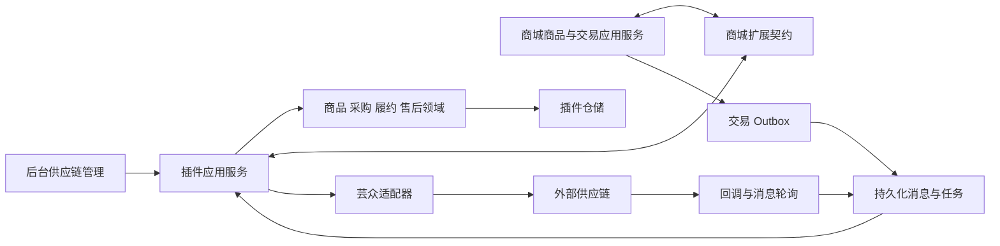
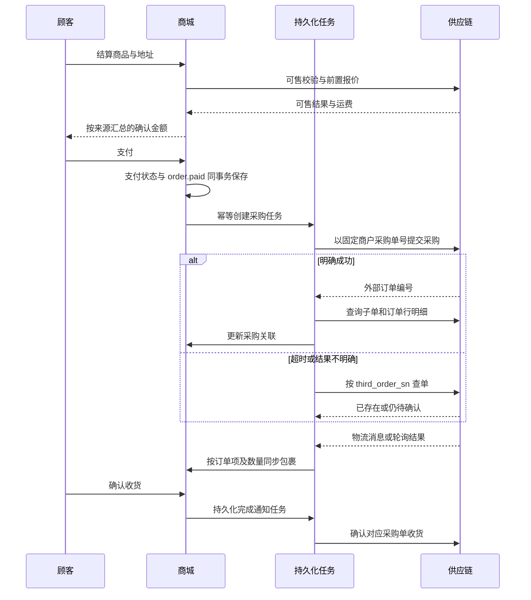

# 供应链插件整体设计方案

日期：2026年10月16日。状态：本地实现与隔离验证已完成，真实供应商协议与部署环境仍待联调。安装和当前行为以 `plugins/supply-chain/README.md` 为准；下文保留协议扫描证据与完整设计目标。

建议新增 `plugins/supply-chain`，插件标识 `since/supply-chain`，首个供应链适配器为芸众中台。首期完成外部商品选品与导入、价格库存同步、支付后采购、物流回传、售后协同、异常补偿和后台管理。模型从第一版按多个供应链连接隔离，后台可以先只配置一个连接。

封装方式以本项目 `wechat` 插件的接口、工厂、Handler、统一配置解析和延迟初始化为参考，重新实现供应链能力。旧 `yz-supply` 作为协议和业务行为的参考资料，不复制其 Controller、静态 Service、全局配置或文件消息队列作为新插件实现。插件后台选品并导入本系统是首期必需功能，具备完整页面、导入操作和结果管理。

商品拉取、导入、同步、订单推送及每次失败重试必须记录可在插件后台查询的日志，包含相关业务参数、执行结果和失败原因。后台耗时操作通过独立 Redis 队列执行，Worker 利用 Hyperf 协程处理独立 I/O，同时实施并发限制、任务幂等和可靠恢复。

商城继续管理顾客、销售订单、收款、促销和客户退款；插件管理外部商品标识、采购订单、供应商履约和采购售后。一个商城销售订单允许关联多个采购单，采购单还可能被上游拆成多个子单与包裹。

商品存储采用“统一商城商品表，加供应链独立扩展表”：确认导入的商品进入现有 `products`、`product_skus`，通过通用履约标记识别外部履约商品，来源字段按后台筛选需求选用；尚未导入的上游目录、外部快照、关联关系、同步任务及日志由插件维护。插件单向保存本地 ID，核心不依赖插件表结构。商城商品身份统一，外部供货数据隔离。

已确认的强制边界：供应链插件与主项目只通过公开接口及公开事件协作。主项目不得引用供应链插件实现；插件不得直接引用主项目的具体 Application Service、Domain Service、Repository、Model 或内部 Entity，也不得通过原始 SQL、Query Builder 或 Redis Key 绕开公开接口读写主项目业务数据。公共 Contract、DTO/值对象、事件类型及明确公开的基础设施契约允许依赖。

## 本次实现落地与边界

已落地 `plugins/supply-chain`，插件标识 `since/supply-chain`。SDK 采用 Interfaces → Factory/Manager → Handler → 协议 Client，按连接延迟创建，独立封装商品、选品、报价、采购、采购售后和消息能力。后台命令层使用项目约定的 `Application/Commad` 目录。

- 后台七个功能页：连接设置、选品中心、已导入商品、采购订单、采购售后、任务与重试、接口日志。共 23 个接口、16 个独立权限码。
- 14 张插件表保存连接、外部商品/SKU、单向映射、采购明细、包裹、售后、消息、任务、执行记录和日志。新增 migration 的表和字段（含主键、时间字段）均有注释；外部字符串标识按大小写区分，金额为整数分。
- 商品导入复用核心商品能力接口，默认草稿；保留本地商品和 SKU 身份，支持追加新规格、停用缺失规格、恢复已存在规格。标题、销售价和内容默认由商城运营维护，不随同步覆盖。同步版本使用数据库 attempt 自增序号，跨节点不依赖机器时钟；过期批次及同版本不同内容均拒绝覆盖。
- 供应链商品采用核心通用 `fulfillment_provider` 标记，插件停用后核心仍能识别并拒绝无履约能力的新交易。下单快照冻结连接、上游 SKU、数量、成本与运费，通过公开接口和标量事件交互，不直接读写主项目业务表或库存 Redis key。
- 支付后持久化采购任务，固定商户采购号。发请求前经核心库存 `protect` 校验订单、退款及售后并保护预占，明确受理后 `acknowledge`；不确定结果保留保护并查单。主项目原 Redis/Lua 下单扣库存、Outbox 退款补偿继续使用。
- 四个 Redis 队列独立处理商品、订单、售后和消息，协程并发有界；数据库持久任务负责重试与过期恢复，Redis 只传任务 ID 和投递版本。失败重试留存每次 attempt、参数摘要、原因和审计事件；已发送但结果未知的订单/售后写操作禁止直接重放。
- API 日志发送前落审计意图，发送后记录响应、耗时、HTTP/供应商状态及关联任务。凭证加密保存，Token 和 AppSecret 不回显，日志参数按权限控制并脱敏。消息先持久化并排好刷新任务再确认接收，周期补偿遗漏支付事件。
- 核心通用卸载保护读取插件声明，存在商品映射、采购/售后历史或交易提交时阻止卸载，停用与强制卸载不能绕过。

以下设计目标没有伪装为已验证能力：

1. 本次采用消息池轮询加周期刷新，没有启用未经验证的入站 webhook；云仓供货方向、专辑/充值等仍不属于本期采购插件范围。
2. 普通采购直接取消协议未从旧实现中确认，SDK 明确拒绝，不调用云仓取消接口。客户退款与供应商售后独立，插件不擅自审核或退款顾客订单。
3. 采购售后依照上游订单行政策由管理员显式提交；按行查到的候选售后号只读展示，不能据此自动认领，拆单归属不明确时停止自动处理。未知取消/退货的上游数字状态只记录观察，需供应商核实后处理。
4. `pause_new` 与 `draining` 当前都暂停新增选品/交易并继续存量履约，后者仅表达运营退出意图，不会自动卸载。字段级同步策略编辑、日志归档/保留期和自动对账差额处理可后续扩展。
5. 当前未配置真实供应商凭证、未发送真实采购、未迁移业务数据库。上线需执行 README 的密钥/迁移/安装步骤，并用供应商测试账号验证协议、拆单数量、售后编码和状态。

验证包含纯单元测试、真实隔离 MySQL/Redis 的商品/库存/采购/售后编排、真实队列 Job 消费、并发及补偿、migration 注释与大小写键、后台 Playwright 回归和 Vue 类型检查。隔离测试使用 `/tmp/mine-shop-tests.*` 的独立服务，不读取业务 `.env`。

## 现有插件扫描结论

本方案依据本地 `store513/plugins/yz-supply` 当前源码及 `mine-shop` 当前实现。接口清单描述的是旧插件实际调用契约；服务端签名校验、幂等保证、限流和部分业务状态仍须在开发第一阶段通过芸众测试环境核实，不能仅由客户端代码推定。

### 实际业务方向

| 方向 | 当前接口族 | 本次范围 |
| --- | --- | --- |
| 采购与分销端 | `/app/product/storage/*`、`/app/order*`、`/app/afterSales/*` | 首期重点：外部商品进入商城，商城订单向上游采购 |
| 云仓供货端 | `/app/product/cloud/*`、`/app/order/cloud/*`、`/app/shipping/cloud/*` | 后续独立功能：本地商品发布到上游、接收渠道订单并自行发货 |
| 辅助业务 | 专辑、虚拟库存、分销设置、充值、自提、卡券及其他插件联动 | 按业务需要逐项扩展 |

`YzClient.php` 保留了旧签名实现，但本次扫描未发现插件内活跃的 `YzClient::` 调用，也未找到其依赖的 `YzRequest` 定义。当前商品、订单主链路使用 `CloudRequestService → YzNewRequest → YzNewClient`。因此首期按当前中台协议实现，不同时移植两套 SDK。

源码入口：[CloudRequestService](/Users/yy/PhpstormProjects/store513/plugins/yz-supply/src/services/CloudRequestService.php:20)、[旧 SDK](/Users/yy/PhpstormProjects/store513/plugins/yz-supply/src/services/sdk/YzClient.php:16)。

### API 域名与身份认证

旧插件通常把配置的 `app_url` 拼接 `/supplyapi` 后再拼接口路径，例如 `https://供应链域名/supplyapi/app/product/storage/list`。局域网地址存在特殊分支，新插件不依赖字符串包含 `192.168` 等方式判断环境。

设置页面明确区分 `api_origin` 与 `api_base_path`，默认路径为 `/supplyapi`；自动去除重复斜杠和重复前缀，并展示最终请求地址。业务方法只允许访问适配器内登记的相对路径。

认证过程如下：

1. `POST /app/application/getToken`，提交 `app_key`、`app_secret` 和 `message_id`。
2. 读取 `data.token` 和 `data.expiresAt`；旧代码以毫秒时间比较过期时间。
3. 后续请求携带 `x-token`，并计算 `Api-Sign`。
4. 旧响应按 `code=0` 成功处理，`code=6` 表示 Token 过期；网络异常由客户端包装成 `code=7`，后者不能视为服务端正式错误码。

新插件的 Token 缓存键必须包含连接 ID 和凭证版本，设置提前刷新窗口与刷新互斥锁；Token 失效仅刷新后重试一次，并保留原业务参数。多连接、多协程之间不能复用可变请求对象。

证据：[地址和公共参数](/Users/yy/PhpstormProjects/store513/plugins/yz-supply/src/services/sdk/YzNewRequest.php:26)、[Token 获取与缓存](/Users/yy/PhpstormProjects/store513/plugins/yz-supply/src/services/CloudRequestService.php:1225)、[过期判断](/Users/yy/PhpstormProjects/store513/plugins/yz-supply/src/services/CloudRequestService.php:183)。

### 签名与加解密

当前源码的核心签名算法为：

```text
按参数键名 ksort 排序
签名原文 = key1 + value1 + key2 + value2 + ... + appSecret + body
签名结果 = strtoupper(md5(sha1(签名原文)))
```

这里的 `sha1` 和 `md5` 都使用 PHP 默认的十六进制字符串结果；不是 HMAC，也不是对报文加密。GET 通常不拼 body，POST/PUT 等拼 JSON body。签名参数包含 `Api-App-Key`、`Api-Time-Stamp`、`Api-Nonce`，普通业务请求还加入 `x-token`；GET 还加入业务查询参数。生成本次签名时应从新参数集合开始，避免前次 `Api-Sign` 混入。

实际请求头包含 `Api-Time-Stamp`、`Api-Sign`、`appKey`、`appSecret`、可选 `x-token`。`Api-App-Key` 和 `Api-Nonce` 对应的 header 在旧代码中被注释，GET 会随参数进入 URL；这说明不能凭签名函数自行重构服务端契约，必须制作签名样本核对 POST 的实际校验规则。

在本次扫描的商品、订单 SDK 与业务链路中未发现 AES、RSA 或其他业务报文加解密。`message_id` 的 Base64 只是编码，不能当作加密，也不能当作业务幂等键。新插件的 AppSecret 静态加密是新增本地能力，和芸众传输协议分开实现。

需要处理的兼容问题：

| 旧实现 | 新方案 |
| --- | --- |
| nonce 使用 `md5(appKey + timestamp)`，其中 `+` 是数值加法 | PHP 8.2 下非数字 appKey 存在类型错误风险；第一阶段核对服务端是否依赖该生成方式，再确定兼容 nonce 算法，不能直接改成拼接后假定兼容 |
| 签名后把 JSON 解码，再交给 Guzzle `json` 重新编码 | 验证签名是否按原始字节校验；统一序列化一次，再对最终 body 签名和发送 |
| Token 过期分支递归调用 `$this->YzNewClient($url,$type)` | 旧代码漏传原 data；新客户端保留 method、path、query、body，限定重试次数 |
| GET/POST 辅助方法根据 body 是否为空选择实际 HTTP 方法 | 明确 method；逐接口核对旧代码中名为 POST、实际可能 GET 的特殊调用 |
| GET/POST 的 Guzzle 配置 `verify=false` | 正式环境验证 TLS 证书；域名、重定向目标和媒体下载地址受控 |
| 日志序列化整个 request，包含 AppSecret 与 Token | 只记脱敏业务字段、request ID、耗时和错误；凭证及含密钥的旧消息字段禁止落普通日志 |

证据：[签名及 header](/Users/yy/PhpstormProjects/store513/plugins/yz-supply/src/services/sdk/YzNewClient.php:93)、[签名原文](/Users/yy/PhpstormProjects/store513/plugins/yz-supply/src/services/sdk/YzNewClient.php:169)、[nonce](/Users/yy/PhpstormProjects/store513/plugins/yz-supply/src/services/sdk/YzNewRequest.php:82)、[HTTP 发送](/Users/yy/PhpstormProjects/store513/plugins/yz-supply/src/services/sdk/YzNewClient.php:312)、[Token 重试](/Users/yy/PhpstormProjects/store513/plugins/yz-supply/src/services/CloudRequestService.php:1202)。

### 旧商品同步方式

旧插件先将商品加入上游选品库，再分批拉详情、通过 Pipeline 写入本地。SPU 及 SKU 分别保存外部 ID 与本地 ID 的映射；SKU 更新会尝试保留已有本地 option ID。价格通常由上游分转换为旧商城元，价格策略覆盖指导价、协议价、营销价、原价及比例。

同步链路同时使用推送回调和消息池：

- 回调读取原始 body，追加到按分钟命名的本地文件，再返回 `code=0`。
- 每分钟扫描文件，按消息类型处理商品变更、上下架、删除、发货和售后。
- 每分钟调用消息池，每次请求 100 条；写入本地文件后调用 `deleteMessage` 确认接收。
- 订单重推、物流补偿每 10 分钟运行，售后补偿每 30 分钟运行。

旧同步有可借鉴的单品价格锁、内容同步开关和利润保护，但实现不能直接照搬：消费文件在业务处理前删除；部分商品查询缺少中台配置 ID 限定；图片锁只保留部分图片字段；规格与属性存在删除重建；消息池转换还会遗漏 `is_stock`。这些问题分别影响消息重试、多连接隔离、运营编辑保护和库存更新效率。

证据：[导入与更新管道](/Users/yy/PhpstormProjects/store513/plugins/yz-supply/src/services/YzGoodsService.php:191)、[字段控制](/Users/yy/PhpstormProjects/store513/plugins/yz-supply/src/pipe/ControlGoodsProcess.php:44)、[文件先删后处理](/Users/yy/PhpstormProjects/store513/plugins/yz-supply/src/services/TimedTaskService.php:62)、[消息池](/Users/yy/PhpstormProjects/store513/plugins/yz-supply/src/services/YzSupplyMessagePool.php:49)、[定时频率](/Users/yy/PhpstormProjects/store513/plugins/yz-supply/src/PluginApplication.php:1655)。

### 旧订单链路与边界

普通链路是可售校验、前置校验及运费试算、商城订单支付、上游采购提交、物流回传、商城确认收货、上游确认完成。另有预占模式，通过 `orderConfirmOnly` 创建未支付采购单，再调用 `orderPayOnly`。

旧插件的供应链本地状态 `0 初始化 / 1 待提交 / 2 待第三方发货 / 3 解锁` 与商城订单状态独立，不能直接移植为新商城主订单状态。旧代码中的 `order.cancel` 消息处理被注释，采购端普通已支付订单的自动取消能力不能据此认定存在。

`/app/order/cloud/cancel` 主要属于云仓接口族，旧插件也用于部分预占订单取消；它是否支持本次采购订单以及各上游来源，必须单独验证。支付后取消优先按采购售后流程处理，不把本地“取消成功”直接等价为上游已撤单。

证据：[取消消息注释](/Users/yy/PhpstormProjects/store513/plugins/yz-supply/src/services/TimedTaskService.php:132)、[预占与支付接口](/Users/yy/PhpstormProjects/store513/plugins/yz-supply/src/services/CloudRequestService.php:759)。

## 功能规划

### 后台页面

| 页面 | 功能与展示 |
| --- | --- |
| 概览 | 已连接供应链、可售商品、待推单、结果待确认、采购失败、物流异常、售后待处理、消息延迟 |
| 供应链设置 | 域名、API 路径、AppKey、AppSecret、连接检测、连接模式、同步策略、采购方式、回调说明 |
| 选品中心 | 全部可选商品、上游已选品、已导入本系统三个视图；按连接、来源、供应商、分类、关键词筛选；详情、SKU、价格库存及选中导入 |
| 导入任务 | 选中导入、按筛选导入、同步进度、成功与失败数量、失败原因、逐项重试、暂停恢复 |
| 已关联商品 | 本地与外部 ID、最后同步时间、售价策略、字段锁、同步异常、暂停销售、解除关联 |
| 分类与物流映射 | 外部分类别名到本地分类、地区编码、快递公司映射、未匹配项处理 |
| 供应链订单 | 销售单与采购单对照、外部子单、采购成本及运费、推送状态、包裹、异常与操作记录 |
| 供应链售后 | 客户售后与采购售后对照、申请类型、数量、两侧金额、退货地址、退货物流、上游审核结果 |
| 同步任务与消息 | 消息接收及消费状态、重试次数、失败详情、手动查单、重放、对账结果 |
| 日志中心 | 商品拉取/同步、订单推送、接口请求和重试历史；按任务、商品、订单追踪参数、响应、失败原因及操作人 |

现有商城商品列表增加供应链来源标签和关联入口；现有商城订单详情增加采购与履约区域。后台的“供应链订单”是采购管理视图，顾客仍查看原商城销售订单。

### 插件后台选品到本系统

运营进入“插件中心 → 供应链 → 选品中心”，在本系统后台完成浏览、筛选、选品及导入。外部商品页通过服务端供应链接口获取，前端只调用本系统接口；不要求先去上游后台选品，不要求手工填写商品 ID，也不要求预先把全部供应链商品下载到本地。

选品中心提供三个清晰区分的视图：

| 视图 | 数据与操作 |
| --- | --- |
| 全部可选商品 | 查询当前连接开放的商品，支持关键词、供应商、来源、分类、价格区间、库存/上下架等可用筛选；支持单个和批量选品导入 |
| 上游已选品 | 查询当前连接在供应链侧已加入选品库的商品；标出已导入、未导入、导入失败，支持将上游已选品导入本系统 |
| 已导入本系统 | 以本地关联关系为准，展示本地商品编号、上架状态、价格策略、同步状态；可打开本地商品编辑或手动同步 |

商品卡片/表格展示主图、标题、供应商、采购价区间、建议售价区间、库存及本地导入状态。详情展示完整规格、各 SKU 价格和库存、图文详情、配送及售后能力；缺少上游数据时不虚构承诺。价格区间从对应 SKU 计算，不沿用旧插件用第一条 SKU 代表全部规格的做法。

用户操作流程为：

1. 选择供应链连接，浏览或筛选商品，查看详情；可单选、多选、跨页选择。不同连接的勾选集合隔离，切换连接不带入另一连接的商品 ID。
2. 点击“导入本系统”，设置目标本地分类、售价策略、字段同步策略、重复商品处理方式。首期以完整 SPU 及其可用 SKU 为导入单位。
3. 展示导入预览，包括预计商品/SKU 数量、已有商品、分类未匹配和无可售规格等问题。重复商品默认跳过，可明确选择按当前字段保护规则同步，禁止静默覆盖运营修改。
4. 提交后生成任务，后台先处理上游选品，再拉详情并创建本系统商品；页面立即返回任务编号，持续显示成功、跳过、失败及处理中数量。
5. 任务成功项可以直接进入本地商品管理，失败项展示原因并单独重试；导入默认下架，由运营核对后通过商城现有上架流程销售。

批量操作明确区分“已勾选商品”和“筛选结果全部商品”。后者由服务端分页枚举并固化实际处理 ID、筛选条件和连接；上游不提供快照能力时不承诺枚举期间商品集合完全不变，执行前重新校验可售和详情。前端不把“本页全选”误显示成“全部结果已选”。

“上游加入选品库成功”与“本地导入成功”分别记录。只有本地 SPU、SKU、分类及映射事务完成，才将该项标记为已导入。上游成功、本地失败时保留可恢复状态；导入失败不自动撤销可能早已存在的上游选品关系。浏览商品或打开详情不会自动调用 `addStorage`，用户提交导入任务后才执行。

导入前后保持现有商城商品能力：导入成功的商品进入本系统标准商品表和 SKU 表，能在本地商品管理中编辑、上架并进入商城交易流程；插件保留来源和同步映射。解除本地关联与移出上游选品库是两个不同操作，已有订单继续使用下单快照。

参考旧功能入口：[后台选品提交](/Users/yy/PhpstormProjects/store513/plugins/yz-supply/src/admin/GoodsImportController.php:265)、[选品和导入编排](/Users/yy/PhpstormProjects/store513/plugins/yz-supply/src/services/GoodsImportService.php:37)。

### 设置页面

必填项为连接名称、供应链类型（首期芸众）、API 域名、AppKey、AppSecret。补充配置包括 API 路径、连接启用状态、请求超时、并发/限流、消息轮询、价格策略、字段同步策略和异常通知接收配置。

保存配置与检测连接分开。检测依次验证地址格式、TLS、Token、商品读取权限和订单查询能力，展示失败所在阶段。检测不创建采购单、不充值。

AppSecret 使用独立凭证加密组件加密落库；主密钥由部署环境提供，不写数据库或仓库。读取和保存响应只返回 `has_secret`、脱敏值及凭证版本；编辑时不传 secret 表示保留，清除和替换是明确操作。Token 仅保存在服务端缓存。更换域名或 AppKey 可能切换上游身份：有商品/订单关联时默认新建连接，密钥轮换才沿用连接并使旧 Token 失效。

本地密文建议使用 AES-256-GCM 这类带认证的加密方式，每次加密生成随机 nonce，保存密文、nonce、认证 tag 和 key_id，并支持主密钥轮换。解密只在服务端构建外部请求时执行；Base64 只可作为密文容器编码，不能替代加密。

设置页中的业务运行模式定义为：

- `active`：正常导入、销售、采购和售后。
- `pause_new`：暂停新导入和新销售；已付款订单按既定采购政策处理，已有物流与售后继续同步。
- `draining`：停止新增业务，持续处理已有采购、履约和售后直到收尾。

已经收款的待采购订单不能因暂停设置悄悄遗漏，必须继续采购或进入可见人工处理队列。插件物理禁用会移除运行能力，有未完成采购或售后时需阻止物理禁用和卸载；确需紧急停用时明确展示积压与恢复办法。

这一保护需要接入插件管理入口的前置检查，不能仅在插件 `uninstall()` 中抛异常：当前插件管理器会捕获该钩子异常并继续卸载。部署流程也应检查未完结任务，物理启停需要协调应用和队列 Worker 重启；不能把前端隐藏菜单视为服务已停用。证据：[卸载流程](/Users/yy/PhpstormProjects/mine-shop/vendor/since-leoo/hyperf-plugin/src/PluginManager.php:265)。

卸载前置检查覆盖仍可支付的待付款销售单、已收款尚未建立采购分组的销售单以及已有采购/售后。停用与数据库升级分开处理；当前仍安装的停用插件迁移可能照常执行，因此迁移必须兼容历史任务与版本。

### 首期与扩展边界

首期交付普通实物商品采购闭环，支持多个连接、价格库存同步、按来源报价、多个采购单、部分发货、退款/退货退款和可靠补偿。未完成多来源报价与部分发货扩展之前，灰度阶段只开放单一来源独立结算，不能提前放开混合购物车。

后续扩展为上游预占采购、换货、本地商品反向供货、云仓渠道订单、自提、专辑、虚拟库存、批量代客下单及财务充值。是否支持某个来源的退款、换货、改地址等由适配器能力声明决定，不向用户展示上游不支持的按钮。

## 总体架构与项目集成



### 参考 wechat 的能力封装

`wechat` 的真实调用方式是 `ConfigProvider` 将接口绑定到工厂，工厂通过 `WechatSettingsResolver` 读取配置，再创建实现接口的 Handler。小程序工厂先返回 `LazyMiniAppHandler`，使用能力时才解析配置和实例化 SDK。这些结构适合复用到供应链插件；配置来源以实际 Resolver 的后台配置为准，不沿用 README 中旧的环境变量说明。

| wechat 的模式 | 供应链的对应设计 | 职责 |
| --- | --- | --- |
| `Interfaces/MiniAppInterface` 等 | `Interfaces/SupplyChainManagerInterface`、`SupplyChainClientInterface` 及商品/订单等能力契约 | 调用方依赖稳定接口，输入输出使用明确 DTO/值对象 |
| `Factory/MiniAppFactory` | `Factory/SupplyChainFactory` | 作为容器工厂创建供应链 Manager，绑定配置解析器、驱动注册表和客户端创建器 |
| `Handler/MiniAppAppHandler` | `Handler/Yunzhong/*Handler` | 芸众协议参数与统一模型转换，按商品、选品、报价、订单、履约、售后和消息拆分 |
| `Construct/AbstractWechat` | 可选的 `Construct/AbstractSupplyChainClient` | 只保留各客户端共有的构造及能力组织；HTTP、签名、Token 用组合组件承接 |
| `WechatSettingsResolver` | `Service/SupplyChainSettingsResolver` | 根据显式 connection_id 解析连接配置、凭证版本和运行模式，不依赖当前 HTTP 请求 |
| `LazyMiniAppHandler` | `Handler/LazySupplyChainClient` | 调用时才初始化对应连接；无配置时仍能正常打开插件设置和商城其他页面 |
| `ConfigProvider` | 插件依赖注册、驱动注册和监听器配置 | 集中组装，不在控制器中创建 SDK 或读取密钥 |

入口采用“注入 Manager → 选择连接 → 使用具名能力”的形式。例如以下为计划中的插件内部用法：

```php
$client = $this->supplyChains->forConnection($connectionId);
$page = $client->catalog()->search($query);
$detail = $client->catalog()->detail($externalProductId);
```

`catalog()` 负责查询外部商品，`selection()` 负责查询和管理上游选品关系；两者区分读取操作和远端写入操作。“导入本系统”由 `AppSupplyProductImportCommandService` 编排，调用选品及商品能力，再经本地商品导入领域服务和商城应用契约持久化。客户端 Handler 不写本地商品表，不管理本地订单状态，也不承担整个同步任务。

选品查询调用链为 `后台 Controller → Application → Manager/能力接口 → 对应连接的 Handler → SDK Client → 芸众 API`；工厂和 Resolver 负责能力实例的创建与配置。导入任务另经 `Application → 商品导入领域服务 → 商城商品应用契约` 写入本地数据。这样接口封装和本地业务可以分别测试，也可以替换供应商驱动。

公开能力契约只定义操作和数据类型，供应商原始返回由 Handler 转为统一分页、商品、报价、采购和售后对象。芸众字段 `spu/sku/order_sn/third_order_sn`、响应成功码与异常结构限制在适配器内部；上层围绕商品、商户采购编号和业务状态处理。Domain 中保留本地定价、导入冲突、采购状态机和重试决策，Application 负责事务与用例编排。

供应链多连接运行需要在 wechat 模式上补充：

- 每个客户端绑定一个明确连接及配置版本，禁止通过全局 `setConfig()`、静态属性或请求参数切换共享客户端。
- 采用请求/任务作用域客户端，或按连接与配置版本隔离的不可变实例。保存设置后后续调用读取新版本，Token 同步失效；不得永久复用微信 Lazy Handler 那样首次成功后不再核对配置的实例。
- 配置读取失败不缓存失败客户端；Handler 和 SDK 依赖通过构造注入，队列与定时任务不依赖 HTTP Request 对象。
- Token、签名、HTTP 发送、错误解析、脱敏日志分别封装为可测试组件；只封装一套传输层，避免复制多个 cURL 方法。
- 对外只提供明确方法，低层 `request/getClient` 限制在驱动内部，避免通过 `__call` 或任意 URL 请求绕过统一协议和任务规则。
- 采购、退款等写操作的重试由业务任务管理；客户端统一认证处理，但不会把网络异常自动转换成重复采购。

证据：[wechat 依赖绑定](/Users/yy/PhpstormProjects/mine-shop/plugins/wechat/src/ConfigProvider.php:33)、[小程序工厂](/Users/yy/PhpstormProjects/mine-shop/plugins/wechat/src/Factory/MiniAppFactory.php:23)、[配置解析器](/Users/yy/PhpstormProjects/mine-shop/plugins/wechat/src/Service/WechatSettingsResolver.php:26)、[延迟初始化](/Users/yy/PhpstormProjects/mine-shop/plugins/wechat/src/Handler/LazyMiniAppHandler.php:82)。

### 插件目录与业务分层

采用现有插件目录、ConfigProvider、迁移和后台插件入口，能力封装沿用 wechat 的命名习惯，后台与本地业务继续遵守项目 DDD 分层。建议目录如下：

```text
plugins/supply-chain/
  plugin.json
  src/Plugin.php
  src/ConfigProvider.php
  src/Interfaces/
  src/Factory/SupplyChainFactory.php
  src/Handler/LazySupplyChainClient.php
  src/Handler/Yunzhong/{Catalog,Selection,Quote,Order,Fulfillment,AfterSale,Message}Handler.php
  src/Construct/AbstractSupplyChainClient.php
  src/Service/{SupplyChainManager,SupplyChainSettingsResolver}.php
  src/Interface/Admin/{Controller,Request,Dto,Transformer}/
  src/Interface/Callback/
  src/Application/{Command,Query}/
  src/Domain/{Connection,Catalog,Purchase,Fulfillment,AfterSale,Sync}/
  src/Infrastructure/{Persistence,Security,Logging,Queue,Crontab}/
  src/Infrastructure/Queue/{Job,Process}/
  src/Infrastructure/Sdk/Yunzhong/{Client,Signer,TokenManager,ResponseNormalizer}.php
  migrations/
  web/{api,views,components}/
  tests/
```

目录落位以仓库邻近实现为准。`Interfaces` 为纯能力契约，`Interface` 为 HTTP 接口层；Handler 在职责上属于外部适配层，沿用 wechat 目录命名。调用遵循 `Controller → Request::toDto → Application → Domain → Repository`；Application 负责事务与编排，复杂采购/售后状态使用 Entity，接口展示使用 Transformer。协议签名和 HTTP 位于 Infrastructure/Sdk，核心领域不依赖芸众字段。

供应商协议通过商品、选品、报价、采购、履约、售后、消息等具名能力契约封装，由适配器声明支持范围，避免所有供应商被迫实现云仓或换货接口；不再建立一组内容重复的 Gateway 包装。`source_type`、`connection_id`、履约模式与商城 `order_type` 分离：当前 `normal/seckill/group_buy` 表示交易类型，供应链不是新的促销订单类型。商城核心只依赖自身扩展契约，由插件桥接，供应链 Manager 和 Handler 不泄漏到核心业务中。

### 已确认的接口与事件接入约束

这里的“接口”是可通过依赖注入调用的 PHP 公共契约，同一进程内无需绕行 HTTP。对外供应链 HTTP 请求仍封装在插件 SDK 内。公共契约归主项目或既有公共契约模块所有，按已有 `app/Domain/Infrastructure/Plugin/Contract` 及交易 Contract 的组织方式落位；供应链 Manager、芸众能力接口和插件内部 DTO 归插件所有，不作为核心依赖。

依赖关系为：核心业务依赖核心契约，插件适配器实现核心契约；插件调用核心公开能力时也只注入核心契约。主项目内部的实现可以使用自身领域服务和仓储，插件内部的实现可以使用自身领域服务和仓储。双方的具体实现仅由各自容器配置组装，不把 `new`、静态调用或 `container->get(具体业务类)` 作为跨边界的替代入口。

最小接口范围按实际用例拆分，以下为能力清单，具体名称实现时按项目规范确定，不预建大而全的插件框架：

| 方向 | 公开能力 | 边界 |
| --- | --- | --- |
| 插件 → 核心 | 商品查询、受控导入与更新 | 返回本地 ID 和公开快照 DTO；保留 SKU 身份、校验字段归属，不返回 ORM Model/Builder |
| 插件 → 核心 | 库存快照协调与可售状态更新 | 核心执行原子预占协调及缓存更新；插件不直接操作核心库存表或 `product:stock` |
| 插件 → 核心 | 订单/售后只读快照与补偿查询 | 查询冻结的订单项和履约信息，按游标分页；恢复任务也不能直接扫描核心订单表 |
| 插件 → 核心 | 包裹、发货及售后状态命令 | 核心校验数量、状态与幂等，再执行自身领域规则 |
| 插件 → 核心 | 客户退款申请 | 复用核心退款授权、审核、金额与幂等规则；供应商退款通知不能直接触发未经授权的客户退款 |
| 核心 → 插件实现 | 履约可用性、配送/报价及售后策略 | 只返回统一结果 DTO；核心决定交易是否继续，不接收可执行回调或供应商原始状态 |
| 核心 → 插件实现 | 下单时供货快照贡献 | 外部报价先在事务外获取；事务内只做本地校验和不可变快照保存，与销售订单保持一致 |

输入输出以明确的公共 Contract、不可变 DTO/值对象和标量 ID 表达，不传递主项目或插件内部的 Model、Entity、Repository、Query Builder。接口结果不携带需调用方操作的可变内部对象；外部原始响应、连接配置及私有异常结构不得泄漏。领域错误按主项目既有异常约定处理，接口文档声明可判别的失败原因。

事件用于已经发生的事实。复用可靠的支付成功、取消、完成和退款成功事件，并为必要的售后动作补齐持久化事件。公共事件载荷包含稳定事件 ID、业务 ID、发生时间及载荷版本，业务版本仅在发布端能够可靠维护时提供。旧内部事件若携带可变 Entity，由核心适配为公共事件/快照，插件不调用该 Entity 的方法或依赖其结构。

要求即时结果的可售校验、报价、售后策略及同事务快照用同步接口；支付后采购、消息处理和重试用持久任务与 Redis 队列。可靠事件监听器幂等写任务并参与既有事务，不发起供应链 HTTP；事务提交后由分发器投递队列。快照写入使用同一数据库事务和公开事务契约，不能先提交销售订单再靠异步监听补充采购路由。

需要参与导入/下单事务的公开命令必须声明事务语义：同一数据库连接参与调用方事务，不另开独立连接提前提交，内部不执行不可回滚的外部请求或 Redis 投影写入。缓存和库存投影通过提交后的可靠任务刷新；事务回滚时不留下可售的孤立商品。通用订单扩展快照带能力标识和载荷版本，核心只负责保存与识别履约依赖，供应商私有字段由插件解释，凭证不进入快照。

插件在 `ConfigProvider` 内通过既有 `plugin_capabilities` 声明契约到实现的绑定并注册监听器，核心复用 `OptionalCapabilityFactory` 解析能力，不再新建平行注册框架。核心依赖配置只引用自身契约和默认实现，不写供应链实现类名。插件停用后，本地商家履约继续工作，需要外部履约的商品由核心持久标记识别并拒绝新交易。默认实现必须明确返回不可用，不能把供应商履约默认为成功；配置错误不能静默掩盖。核心不得为检查插件状态而引用供应链的 ConfigProvider、Manager、Handler 或仓储。通知、导出等其他插件能力也通过公开接口接入，不增加插件间的具体实现依赖。

现有注册机制证据：[能力解析器](/Users/yy/PhpstormProjects/mine-shop/app/Infrastructure/Plugin/OptionalCapabilityFactory.php:19)、[核心契约绑定](/Users/yy/PhpstormProjects/mine-shop/config/autoload/dependencies.php:74)。当前 `order.created` 和 `order.cancelled` 转换仍携带内部订单实体，供应链接入时需由核心增加公共载荷适配；支付、退款及完成事件可复用其标量业务信息。证据：[事件转换位置](/Users/yy/PhpstormProjects/mine-shop/app/Application/Api/Order/AppTradeRecoveryService.php:109)。

实施验收增加以下架构约束：

- 核心业务代码不存在对 `Plugin\\SupplyChain\\` 实现的依赖；供应链业务代码对 `App\\` 的依赖限于约定的公共契约、公共数据类型和公开基础设施入口。
- 检查跨边界的静态调用、容器动态取类、原始 SQL 及 Redis 写入，防止“方法有接口、内部仍直接操作对方数据”。跨表查询也通过只读接口实现。
- 契约测试覆盖禁用/缺失插件、重复事件、过期报价、库存同步与预占并发、退款与采购并发；核心业务测试可以使用接口替身，不需加载芸众 SDK。
- 插件侧数据表只保存本地 ID 及业务快照，不创建到核心表的强制外键或反向 ORM 依赖；生命周期约束和对账通过公开接口执行。

### 可以复用的现有能力

| 现有能力 | 复用方式 |
| --- | --- |
| 插件 manifest、ConfigProvider、迁移、菜单和前端插件入口 | 注册 `since/supply-chain`，提供独立设置页和业务菜单 |
| 商品、SKU、分类及订单领域 | 外部商品导入本地标准商品；采购关联放在插件表 |
| `trade_outbox` 的 `order.paid` | 触发供应链采购任务，避免另建支付回调链路 |
| Redis、Hyperf AsyncQueue、Crontab | 运行按连接限流的异步同步和补偿任务 |
| 系统消息与导出插件 | 供应链异常通知、商品导入失败清单和采购订单导出 |

当前 `order.paid` 在恢复器中转换为 `OrderPaidForMember` 事件。恢复器在数据库事务和行锁范围内 dispatch，因此供应链监听器只能幂等地写本地任务，不能直接请求外部 API。后续由任务分发器提交队列，队列不可用时数据库任务仍可补发。

当前交易 Outbox 的事件分发类型是固定映射，不能直接写入任意 `supply.*` 后假定恢复器会执行。已存在 `order.completed` 分发，应优先复用；新增售后等核心事件时同时补分发映射。插件自己的采购与同步任务由独立调度器负责。供应链单次外部请求和重试时间需与专用队列的超时、任务租约匹配，不能直接使用公共队列默认 10 秒处理超时。

恢复任务还需扫描“含供应链来源快照、已支付但缺采购任务”的订单，按唯一业务键补建任务。这覆盖插件临时未加载、支付事件已被其他监听器处理完的情况；不能假定所有事件都会在插件恢复后自动重放。

前端源码置于插件 `web` 目录，同时增加 `web/src/plugins/since/supply-chain/index.ts` 转导入口，适配现有前端扫描方式。后台为设置读取/修改、连接检测、导入、调价、订单查询/补推、售后操作和日志查看分别设置权限，并复用操作审计；敏感配置与采购成本不向普通商品操作员开放。

证据：[交易恢复](/Users/yy/PhpstormProjects/mine-shop/app/Application/Api/Order/AppTradeRecoveryService.php)、[插件配置样例](/Users/yy/PhpstormProjects/mine-shop/plugins/express/src/Plugin.php)、[DDD 规范](/Users/yy/PhpstormProjects/mine-shop/docs/DDD-ARCHITECTURE.md)。

### 必须补充的商城能力

| 能力 | 当前限制 | 本次设计 |
| --- | --- | --- |
| 按履约来源报价 | 普通流程主要使用本地运费模板和省级条件 | 增加按商品来源路由的库存、可售、运费报价契约，支持完整地区和地址输入 |
| 订单来源快照 | 缺少采购路由的稳定历史快照 | 下单时记录连接、外部 SPU/SKU、来源、报价及版本；后续推单不读取可变映射替代快照 |
| 部分发货 | `OrderEntity::ship` 一次发货直接整单 shipped；包裹项表已有迁移但当前流程未完整使用 | 核心增加按订单项和数量发货服务，聚合 partial_shipped/shipped，支持增量包裹和幂等 |
| 部分履约后的收货 | `OrderEntity::complete` 允许 partial_shipped 直接整单完成 | 补充应履约数量与收货聚合校验，统一人工和自动收货规则 |
| 库存同步 | 普通商品更新会直接设置 Redis 库存 | 新增保留本地预占的供应链库存写入通路，并处理远端库存快照版本 |
| 售后数量与金额 | 已有单订单项售后，但累计可退数量、优惠后逐项可退金额仍需完善 | 冻结订单项实付分摊，事务校验累计申请/退款，不允许重复退同一数量 |
| 售后与收货事件 | 已有支付、退款成功及 `order.completed` 的 Outbox 事件，售后各中间动作未全覆盖 | 复用已有完成事件并核实人工/自动收货入口覆盖；为售后申请、撤销、退回物流等补充持久化事件或事务内任务 |
| 敏感配置 | `is_sensitive` 不等于落库加密，部分保存返回会带原值 | 凭证专用存储、加密组件和脱敏响应，不直接复用通用 JSON 设置返回 |

核心新增契约应为通用“商品来源、报价、履约、售后”扩展点，核心代码不导入 `Plugin\SupplyChain`。插件通过核心应用契约调用商品/发货/退款能力，不能直接更新商城订单状态。

核心来源标记在插件未加载时仍须生效：已绑定供应链的商品应判为来源不可用，禁止下单，不能因为能力 fallback 而按自营商品继续销售。供应链插件卸载保留采购、映射和售后历史，采用 `rollback_on_uninstall=false`。

证据：[当前发货行为](/Users/yy/PhpstormProjects/mine-shop/app/Domain/Trade/Order/Entity/OrderEntity.php:412)、[包裹写入](/Users/yy/PhpstormProjects/mine-shop/app/Domain/Trade/Order/Repository/OrderRepository.php:93)、[包裹项迁移](/Users/yy/PhpstormProjects/mine-shop/migrations/2024_01_01_000012_create_mall_order_package_items_table.php:23)、[售后校验](/Users/yy/PhpstormProjects/mine-shop/app/Domain/Trade/AfterSale/Service/DomainAfterSaleService.php:37)、[配置序列化](/Users/yy/PhpstormProjects/mine-shop/app/Domain/Infrastructure/SystemSetting/Entity/SystemSettingEntity.php:277)。

## 商品存储选型

### 推荐统一销售商品和独立供应链扩展

已选品并确认导入本系统的商品，继续使用现有 `products` 和 `product_skus`。核心保留通用履约标记，在插件表保存外部供货数据和本地映射，来源字段按需增加。上游选品库与已经导入的商城商品属于两个层次，只有导入成功才建立商城商品。

| 方案 | 优点 | 代价与适用范围 |
| --- | --- | --- |
| 原商品表只加来源，并塞入全部供应链字段 | 初期读取直接 | API 差异、原始报文、同步策略会持续污染主表，不利于插件隔离 |
| 供应链单独建销售商品与 SKU 表 | 独立保存供货业务数据 | 现有商品详情、购物车、订单、缓存、促销都需支持两套商品身份和查询；适合独立交易系统，不适合本次接入同一商城 |
| 原商品表加通用来源，供应链数据独立扩展 | 共用交易身份和商品管理，外部协议及同步数据独立 | 需要来源路由和映射校验；是本项目建议方案 |

这个选择基于当前代码依赖，而非仅考虑表结构简洁：

- 商品列表、详情和关联查询使用 `Product`、`ProductSku`。本地商品已经具备名称、分类、图片、规格、售价、成本参考、库存和上下架字段，可以表达导入的普通实物商品。
- 购物车直接以本地 `sku_id` 作为 Redis Hash 字段；普通下单按本地 SKU ID 批量读取商品快照。若供应链另有一套 SKU 表，单纯相同数字的 ID 就不足以区分商品，需改造购物车和整个交易接口的身份格式。
- 订单明细保存本地 `product_id`、`sku_id`；秒杀、拼团及商品缓存也关联这一套 ID。共用主表可继续使用现有关系，促销能否开放还要按供货价格、库存及履约能力单独校验，不能因共表而默认全部兼容。
- 在当前商品模型及迁移中未找到 `source_type` 或 `fulfillment_type`，因此需要补充核心可识别的履约标记或等价的持久路由机制及调用规则，不能只依赖插件加载后才能查询的映射来判断是否需要外部履约。`source_type` 仅用于来源查询时可选。

证据：[商品表](/Users/yy/PhpstormProjects/mine-shop/migrations/2024_01_01_000004_create_mall_products_table.php:23)、[SKU 表](/Users/yy/PhpstormProjects/mine-shop/migrations/2024_01_01_000005_create_mall_product_skus_table.php:23)、[购物车身份](/Users/yy/PhpstormProjects/mine-shop/app/Domain/Member/Api/Command/DomainApiMemberCartCommandService.php:46)、[订单商品校验](/Users/yy/PhpstormProjects/mine-shop/app/Domain/Trade/Order/Strategy/NormalOrderStrategy.php:51)、[订单明细关系](/Users/yy/PhpstormProjects/mine-shop/migrations/2024_01_01_000009_create_mall_order_items_table.php:23)、[促销商品关系](/Users/yy/PhpstormProjects/mine-shop/app/Domain/Trade/Seckill/Repository/SeckillProductRepository.php:55)。

### 主表和插件表的职责

| 存储位置 | 保存内容 | 数据权威 |
| --- | --- | --- |
| `products` | 本地商品 ID、标题、分类、图片、详情、运营标签、售价范围、上架状态、来源和履约类型 | 商城展示与销售商品 |
| `product_skus` | 本地 SKU ID、规格、售价、展示市场价、库存投影、重量及状态 | 商城交易使用的 SKU；库存仍经统一库存机制维护 |
| `supply_products`、`supply_skus` | 上游原始及规范化快照、连接、外部 ID、供货价、供应商、上游库存与版本 | 外部供货信息；不是第二套销售目录 |
| `supply_product_links`、`supply_sku_links` | 外部与本地映射、同步策略、字段锁、绑定版本、停供状态 | 采购路由和同步关联 |
| 任务、attempt、API 日志表 | 拉取/同步过程、参数、字段变化、失败与重试记录 | 同步执行和诊断历史 |

上游商品尚未导入时可在线分页读取，并按需要缓存外部目录或保存选品快照；不能为每个被浏览到的上游商品都创建一条本地 `products`。外部快照的存在也不代表商品已导入；只有有效本地映射和成功导入记录才能表示已导入。

共表并不要求覆盖同名字段。上游标题、图片保存在外部快照，本地展示值按字段锁决定是否更新；上游采购价单独保存，`product_skus.cost_price` 仅作为按策略维护的本地成本参考，不代替真实采购单成本。上游库存不是自有仓库存，必须经过预占协调生成本地可售库存，不能把远端 stock 直接写进主表及 Redis。

### 隔离方式与主流程复用边界

采用“插件业务独立，核心交易复用”的方向，关联限定为插件持有本地 ID 的单向映射：

- 不要求插件表与主商品表建立数据库外键，不给 `Product` 增加指向供应链模型的 ORM 关系，也不在普通商品查询中默认联查插件表。没有外键时，由插件的导入事务、唯一约束、生命周期校验和定期对账维护关联完整性。
- 插件必须保留本地 `product_id/sku_id` 与外部 ID 的对应关系，以及本地订单项与采购单行的对应关系。否则无法确定应同步哪个 SKU、采购哪个外部商品或为哪笔采购办理售后；不能用标题或可变商品编码猜测关联。
- 核心只定义通用履约契约和事件，不导入供应链类，不理解芸众状态码。插件实现契约、订阅可靠事件，回写商品、包裹及客户退款时通过核心公开应用契约调用，不直接注入核心具体服务或修改核心状态字段。
- 交易前的可售判断、订单创建时的必要快照必须在相应步骤完成，不能全部改成事后异步事件。订单来源快照与订单同事务保存；外部 HTTP 不放在数据库事务内。支付后采购、采购售后和对账使用持久任务、Redis 队列及协程。

| 环节 | 核心继续负责 | 插件及通用扩展点负责 |
| --- | --- | --- |
| 商品与下单 | 本地商品/SKU 身份、购物车、销售订单、优惠分摊、支付 | 可售和配送校验、采购报价、供货关系快照 |
| 库存 | 统一库存接口及 Lua 原子预占、释放的基础机制 | 上游库存快照、尚未被上游体现的本地预占核对、停供及库存校准 |
| 支付后履约 | 销售订单与付款状态、可靠支付事件、统一包裹/发货服务 | 采购推送、结果未知查单、供应商取消、物流映射和补偿 |
| 退款售后 | 客户售后入口、可退金额校验、原路退款与资金账务 | 上游取消/退货/采购退款、退货地址及两侧状态协调 |

现有 Lua 可复用本地并发扣减能力，但不能保证外部供应商库存，也不能承受同步任务绕开预占核对整值覆盖。例如本地 100 件，用户预占 2 件后剩 98；若上游尚未接单仍返回 100，同步直接写成 100 就丢失了这 2 件预占。供应链库存调整须经统一协调入口与预占/释放原子协作；是否扩展 Lua 由该入口设计决定，不承诺所有库存代码原样不动。

客户退款和供应商采购退款是两笔不同资金业务。可以沿用核心的退款执行能力，但不能把“客户已退款”直接当作“供应商已取消且库存可恢复”。支付后退款可能与排队采购、正在采购或已经发货并发，插件需按采购状态协调；先行赔付是可配置商家政策，之后仍保留采购追偿和对账任务。退款是否恢复本地可售量，取决于该笔预占是否仍有效及上游库存是否已反映变动，不能按退款成功简单加回数量。

如果业务仅为一次性复制外部商品，之后由商家买断入自有仓、自行发货和承担售后，则可以按普通商品运行，持续外部关联可选。本方案包含支付后向供应链推单，按供应商代发设计，不能采用该前提。

这种划分减少核心对插件实现的依赖；保留的是跨系统业务本身需要的状态协调。为追求“核心完全无改动”而仅在退款成功后补通知、定时修补库存，会把必要规则转移为更难排查的隐式依赖。

证据：[Lua 预占与释放](/Users/yy/PhpstormProjects/mine-shop/app/Infrastructure/Service/Trade/RedisStockReservation.php:14)、[当前库存覆盖写入](/Users/yy/PhpstormProjects/mine-shop/app/Domain/Catalog/Product/Listener/ProductSkuStockListener.php:101)、[核心退款申请](/Users/yy/PhpstormProjects/mine-shop/app/Domain/Trade/AfterSale/Service/DomainAfterSaleRefundService.php:39)、[可靠交易事件分发](/Users/yy/PhpstormProjects/mine-shop/app/Application/Api/Order/AppTradeRecoveryService.php:74)。

### 主商品字段建议

最小方案在核心保留一个通用履约标记；来源字段为后台管理的可选项，不能把增加两个字段作为交易复用的前提。字段放在 `products` 最直接，也可用核心拥有的通用扩展表实现等价机制，但不能只存在于插件表中：

| 字段 | 建议值 | 用途 |
| --- | --- | --- |
| `source_type`（可选） | `local`、`supply_chain`；若增加，现有商品默认 `local` | 表示商品数据来源，用于后台筛选；供应链同步策略本身保存在插件中，不依赖此字段运行 |
| `fulfillment_type`（或等价通用机制） | `merchant`、`supplier`；现有商品默认 `merchant` | 表示由本商家还是供应商履约，决定通用履约能力选择；能力缺失时禁止新增交易 |

来源与履约方式是两个维度：外部导入的商品以后可能买断入自有仓，本地创建的商品也可能委托供货。首期只开放已实现的组合：本地商品走商家履约，供应链导入商品走供应商履约；暂不提供随意切换的通用下拉框。

供应商驱动类型 `yunzhong`、连接 ID、外部 SPU/SKU ID、同步游标及接口报文均留在插件表。无需把 `yz_goods_id`、`app_key` 或各家供应链特有字段加到主商品表，也不把 `source_type` 定义成某一家供应商。首期整个 SPU 属于一个连接和一种履约方式，不支持同一 SPU 内不同 SKU 随意混合供货；多货源采购后续单独设计。

来源与履约字段采用明确的领域取值校验，按列表查询需要补充索引，例如 `(source_type, status, id)`。来源及履约关系由受控导入/绑定用例设置，普通商品编辑不能通过默认 DTO 值把供应链商品改回本地商品。公开商品接口不暴露采购价、凭证、外部采购路由等内部字段。

### 映射约束与订单历史

外部商品和 SKU 的唯一性始终包含连接维度，外部 ID 按字符串保存。首期一条本地商品只绑定一个外部 SPU，一个本地 SKU 只绑定一个外部 SKU；同一连接同一外部商品重复导入应复用现有本地商品。对应唯一约束至少覆盖本地 `product_id`、本地 `sku_id` 和相应外部实体键，并校验 SKU 两端都属于对应的 SPU 映射。当前映射与历史版本分开保存，不能仅增加软删除列就认为实现了“当前有效唯一”。

本地商品/SKU ID 及编码由本系统生成，外部 ID 不占用本地主键或 `product_code/sku_code`。同一个外部 ID 出现在两个连接时，分别生成各自的本地商品与映射。取消映射不能自动把商品视为自营：关联缺失、来源失效或插件未加载时保持不可购买，并保留诊断原因。

订单创建时保存来源、履约方式、连接、外部商品/SKU、绑定版本和报价快照。订单项仍使用本地 `product_id/sku_id`；来源快照通过核心通用字段或订单项扩展结构持久化，必须能在插件暂时未加载时识别该订单依赖外部履约。支付后采购、物流及售后使用订单快照，不能从商品当前绑定重新推断历史订单的供货来源。

首期禁止直接修改已有交易商品的供货绑定；换源采用新建商品或后续专门的迁移流程。更换供应链商家账号应新建连接，不能将历史连接 ID 改成另一账号身份。上游商品删除、SKU 消失时保留引用、停售对应商品/规格，不调用现有通用删除流程直接删除历史 SKU。当前商品仓储的删除方法会删除 SKU，需在供应链场景加领域限制。证据：[现有删除行为](/Users/yy/PhpstormProjects/mine-shop/app/Domain/Catalog/Product/Repository/ProductRepository.php:143)。

### 对现有代码的实际改造范围

共用表能复用交易身份，仍需完成以下扩展，不能只添加字段后就开放销售：

1. 通过核心迁移增加履约字段，来源字段按筛选需求选用，已有商品回填相应默认值；修改 Model、Entity、Mapper、Contract/DTO、查询筛选及后台显示。核心字段不随插件卸载回滚。
2. 商品快照、缓存和交易构建必须携带来源及履约信息。当前 SKU 快照采用显式字段列表，要主动补字段并失效/重建旧缓存；旧缓存缺来源时回源确认，不能将未知商品默认为自营。
3. 加入购物车、结算、提交和支付前校验外部履约是否可用，实施供应链报价、库存和运行模式规则；核心的 unavailable fallback 防止插件停用后商品失去限制。
4. 供应链同步通过专用应用入口更新被授权字段，保留 SKU ID。库存同步走专用预占协调入口；仅修改标题或图片也不能用过期 stock 覆盖 Redis 当前可售库存。
5. 本地商品和映射在同一数据库短事务内落库，任务失败可重试；商品快照缓存及库存投影刷新有补偿。导入未完整完成时保持草稿/不可售。
6. 列表页按来源筛选，供应链后台按连接管理映射；商城正常列表不要求逐个商品远程查供应链。上游大目录放在插件侧，避免未选品数据挤占销售目录。

证据：[当前 SKU 缓存字段](/Users/yy/PhpstormProjects/mine-shop/app/Domain/Catalog/Product/Service/DomainProductSnapshotService.php:318)、[当前库存事件覆盖](/Users/yy/PhpstormProjects/mine-shop/app/Domain/Catalog/Product/Listener/ProductSkuStockListener.php:101)。

## 商品同步设计

### 导入与关联

1. 按连接读取分类、供应商、来源和商品列表，运营选择商品或筛选条件。
2. 创建持久化导入任务，记录筛选快照、分页游标、总数和操作者。
3. 调用 `addStorage`，再分批调用 `detailList`；批大小从旧插件的 30/50 条实践起步，实际以接口限制和压测为准。
4. 将上游数据规范化为统一 SPU/SKU、图片、规格、参数、价格和库存快照。
5. 每个 SPU 在短事务内创建/更新本地商品、SKU 和映射。导入默认下架，商品完整性校验及运营审核后上架。
6. 单件失败独立记录，其他商品继续；只有全部子任务结束后才将任务标记为成功或部分失败。

上游加选品成功而本地入库失败时记录为可恢复中间状态，重试沿用连接与外部 ID，避免重复建商品。导入任务暂停时停止领取新批次，已执行批次正常收尾。

外部 ID 均按不透明字符串存储，不假定全局唯一或永久为数字。SPU 唯一键包含连接 ID 与外部商品 ID；SKU 唯一键包含连接 ID、外部商品 ID 与 SKU ID。首期一个本地 SKU 只绑定一个供货来源，多货源择优采购另行设计。

### 选品后台的本系统接口

以下为拟新增的本系统管理接口，并非芸众路径。所有接口检查连接归属及相应操作权限，前端不提交 API 地址或凭证。

| 方法与路径 | 职责 |
| --- | --- |
| GET `/admin/supply-chain/connections/{id}/catalog/products` | 分页浏览全部可选商品，叠加本地已导入/导入中/失败状态 |
| GET `/admin/supply-chain/connections/{id}/catalog/products/{externalId}` | 商品与 SKU 详情；外部 ID 按不透明字符串处理并正确编码 |
| GET `/admin/supply-chain/connections/{id}/catalog/selections` | 上游已选品列表，支持查看尚未导入本系统的商品 |
| POST `/admin/supply-chain/imports/preview` | 解析勾选范围、类别及定价策略，返回导入预览和冲突信息，不加入上游选品库 |
| POST `/admin/supply-chain/imports` | 幂等创建导入任务，固定连接、选择范围和导入策略，返回 task_id |
| GET `/admin/supply-chain/imports/{id}` | 任务阶段、计数和进度 |
| GET `/admin/supply-chain/imports/{id}/items` | 按状态分页查询商品级结果和失败原因 |
| POST `/admin/supply-chain/imports/{id}/retry` | 重试明确失败项，沿用原任务商品及连接，不重复创建本地商品 |
| GET `/admin/supply-chain/products` | 查询已导入本系统的商品关联，供管理和同步页面使用 |

前台点击导入与后台 Worker 都通过同一应用服务和领域规则，不能出现页面直接写本地商品、队列另写一套逻辑的情况。远端选品状态和本地导入状态分别展示；上游暂时不可用时显示可重试错误，不把失败包装成“暂无商品”。

### 字段归属

| 字段 | 默认更新规则 |
| --- | --- |
| 外部 ID、供货来源、外部采购价、供应状态 | 上游主导，持续同步 |
| 原始库存与同步时间 | 上游快照保存在插件；本地可售量通过库存服务计算 |
| 本地售价 | 默认按规则计算，可单品锁价；来源限价能力生效时必须校验 |
| 本地标题、详情、主图、图库、SKU 图片、视频 | 首次导入后运营可编辑；分别配置同步开关，关闭时完整保留对应字段 |
| 本地分类、营销配置、排序、标签 | 本地主导，通过显式映射初始化 |
| SKU 规格与外部存在性 | 保持本地 ID 稳定；上游删除 SKU 时停售并保留历史关系，不直接删除被订单引用的 SKU |
| 上下架 | 上游下架/删除必须停止新销售；上游重新上架不自动覆盖运营手动下架 |

远端快照与本地展示字段分离保存。每次同步保留版本、hash、来源与更新时间，并显示字段差异。消息重复或乱序时优先回查上游最新详情，不能让晚到的旧消息覆盖较新数据。

### 价格与库存

金额在新系统内部统一为整数分，元仅用于展示或必要的边界转换；不要继承旧插件多次除以 100 后浮点计算的方式。采购单价、采购运费、顾客成交价分别保存，客户优惠不会自动变成供应商给商城的优惠。

初始售价策略支持指导价、采购价加固定金额、采购价乘倍率和手动锁价。利润保护明确区分“加价率 = 利润/成本”和“毛利率 = 利润/售价”，处理成本为 0、限价冲突、活动价失效及四舍五入规则。成本涨至超过允许利润阈值时暂停销售并告警，不静默产生亏损采购。

库存维护上游可售快照、本地未被上游体现的预占和安全余量，不能简单将上游库存直接写回商城 Redis。基础思路为 `本地可售量 = max(0, 上游可售快照 - 尚未被该快照体现的本地预占 - 安全余量)`；采购成功后何时释放本地预占，要根据上游扣减时点与库存快照版本确认，避免重复扣减或提前释放。

价格风控、运营暂停和上游停供各自保存独立的禁售原因。库存消息只能更新库存快照，不能通过恢复正库存解除价格风控或手动停售。

结算时仍实时执行可售与前置校验。上游不支持锁库存时，需要明确“报价通过不等于保证采购成功”，支付后缺货进入订单异常处理与退款补偿。库存同步过旧或上游持续故障时按配置暂停新销售。

## 订单采购与履约设计

### 订单模型

一个商城订单可以包含自营商品、连接 A 的商品和连接 B 的商品。结算按来源生成报价组；采购任务至少按连接拆分，并根据上游要求保留供应商、仓库或供货来源分组。一个采购提交结果可以继续关联多个上游子单，不预设一对一关系。

商城保留一个销售订单与支付单，新增插件采购单及采购明细。优惠和支付分摊仍由商城完成，并形成订单项快照；采购成本从供应链报价和实际采购结果记录。此设计不要求把每个采购单变成新的顾客销售订单。

### 正常流程



提交前再次检查本地支付成功、未被取消/退款占用、连接身份、商品快照、报价变化和采购授权策略。外部 HTTP 在数据库事务外执行，结果通过短事务落库。

### 幂等与不确定结果

每个采购分组创建固定、可追踪的 `merchant_order_no`。它与连接 ID 组成唯一键，重试、手动补推和消息回放均沿用；实际长度与字符限制在协议联调时确认。数据库唯一约束、任务租约和每采购单互斥共同防止并发重复提交。

另以 `(sales_order_id, connection_id, immutable_group_key)` 约束采购分组唯一，防止支付事件重放时重新生成单号绕过前一个唯一键。商品来源和分组快照必须先随销售订单可靠保存。

Worker 通过短事务领取任务并记录本次 attempt/version，事务外调用，随后按版本条件写回结果。租约过期的 `submitting` 任务统一进入 `unknown` 查单，不能被新 Worker 当作未提交任务再次 POST；旧 Worker 的迟到结果也按版本核对后合并，避免覆盖已经恢复的状态。

芸众创建请求的字段实际叫 `order_sn`，按商户单号查询时字段叫 `third_order_sn`，适配器将内部 `merchant_order_no` 转成各接口字段。物流查询和地址修改使用 `order_sn`，完成通知使用 `third_order_sn`，物流处理确认使用 `third_order_sn` 数组；取消预占使用上游查单得到的 `order_id`。这些字段不能混用。

旧插件普通采购的主要请求结构为：

```json
{
  "order_sn": "固定的商户采购单号",
  "spu": [{"sku": "外部SKU编号", "number": 2}],
  "address": {
    "consignee": "收货人",
    "phone": "手机号",
    "province": "省名称",
    "city": "市名称",
    "area": "区县名称",
    "street": "街道名称",
    "description": "详细地址"
  },
  "remark": "订单备注"
}
```

上例展示字段结构，SKU 的线路类型以及来源特有必填项以联调样本为准。旧响应 `data.Orders[].order_sn` 可包含多个上游订单；新插件逐条保存关系，不将多个编号拼成一个字符串。不能假定创建响应包含完整订单行：受理成功后主动调用 `orderDetailByThirdOrderSn`，保存全部子单及行 ID，尚未补齐时标记为待补齐并继续查询。

证据：[旧采购请求组装](/Users/yy/PhpstormProjects/store513/plugins/yz-supply/src/services/CreateOrderService.php:152)、[旧采购响应处理](/Users/yy/PhpstormProjects/store513/plugins/yz-supply/src/services/CreateOrderService.php:213)。

采购状态建议为：`pending → submitting → accepted → partially_shipped → shipped → completed`；异常分支为 `unknown / retry_wait / manual_required`，取消与售后另有状态。`unknown` 代表外部可能已成功，不等于失败。

出现网络超时、连接断开或响应解析失败时，先按 `third_order_sn` 查单。不能因为一次查询未查到就立即重下；考虑上游可见性延迟，按退避策略继续查询。在上游未承诺幂等且结果仍不明确时转人工核对，不以自动重复采购冒险。明确业务拒绝则分类处理，余额不足、商品停供、地址不可达等不进行无休止重试。

`orderConfirmOnly/orderPayOnly` 预占模式作为独立能力开关，需验证预占有效期、取消、支付幂等和库存释放后再启用。首期默认支付后采购。

### 运费与报价变化

使用 `availableCheck` 校验商品/地区可售，使用 `beforeCheck` 获得前置校验与采购运费。报价缓存键至少包含连接、SKU 数量、完整配送地址摘要和价格版本；记录有效期。

顾客运费可以按采购运费透传，也可由商城补贴，但结算时必须显示最终运费，保存报价和补贴快照。支付前价格或运费变化要求重新确认；支付后采购成本变化不得再次扣顾客款项，可在商家配置的容差内承担差额，超出则转人工或退款。

### 发货、地址与取消

物流按外部子单、包裹、运单、订单项和数量保存。重复消息采用 upsert，不先删全部包裹；一个采购单多个包裹、多个采购单各自发货都通过统一核心履约应用契约调用。只发一部分商品时商城显示部分发货，全部应履约数量完成后才显示整单已发货。

旧客户端没有证明上游总能提供稳定包裹 ID。有包裹 ID 时直接关联；没有时按连接、外部子单、物流公司和运单等定义组合键，并保存包裹行分配。运单更换需要版本及替换关系，不能误判为新增一份已发数量。一条本地采购明细可能被拆到多个上游订单行，按行 ID 与数量分别保存映射。

已经确认不再需要履约的取消/退款数量须从待履约数量中正确扣除，不能以已经关闭的未发商品阻塞订单完成。售后申请中、被拒绝、或客户先行赔付但上游仍在发货的数量不能直接扣除。快递公司未匹配时保留原始名称/代码并待补映射，不丢弃运单。

整单确认收货前校验全部剩余应履约商品已发出；若开放按包裹确认，则逐包裹记录，全部应完成项满足条件后才完成销售单。自动收货采用对应有效包裹的时间及剩余履约状态，不能把首包发货时间用于尚未发货的商品。只向满足条件的采购子单发完成通知。证据：[当前整单完成行为](/Users/yy/PhpstormProjects/mine-shop/app/Domain/Trade/Order/Entity/OrderEntity.php:430)。

地址在采购前可以按商城规则修改；采购受理后必须先获得上游修改结果，再更新对应履约地址快照，避免两侧地址不一致。采购提交与取消/退款并发时使用本地锁和版本校验，结果不明确时进入查询与补偿，不能宣称远端已取消。

## 售后协同设计

商城客户售后与供应链采购售后分别建模、分别记录金额和状态。客户退款走现有支付退款能力；供应链退款通常退回商城的采购余额或结算账户，两者不能互相替代。

流程为：客户提交售后 → 商城校验订单项可退数量与实付分摊 → 创建采购售后任务 → 上游审核 → 同步退货地址或拒绝原因 → 顾客填写退货物流 → 通知上游 → 上游处理完成 → 按商城退款政策完成客户退款与对账。

商城可配置在上游同意后退款，或由商家先行赔付。先行赔付后仍要追踪采购售后，不能关闭采购追偿记录。部分退款、多个采购子单及多次售后按订单项数量分摊，累计客户退款不能超过实际支付可退额，累计采购退款不能超过对应采购可退额。

上游 `after_sales.*` 消息作为状态变更提示；必要时回查详情，成功处理后才调用 `messageSuccess`。申请、撤销、退货物流和上游结果均要求幂等任务。首期支持退款和退货退款；换货保留能力接口，需补全换出包裹、换货完成和相应后台操作后再开放。

## 消息与任务可靠性

### Redis 队列与协程分工

采用 `hyperf/async-queue` 的 `RedisDriver`，在插件 `ConfigProvider` 注册独立队列和对应 `ConsumerProcess`，通过 `DriverFactory` 显式选择队列。可参考 export-center 的独立通道注册方式；不与商城下单公共队列混用，也不在 Web 请求中创建无人跟踪的后台协程执行采购。

```text
后台操作 / 支付事件 / 定时扫描
  → 数据库任务与业务快照落库
  → 分发器投递 Redis 队列（task_id、dispatch_version）
  → Consumer 协程领取任务并记录 attempt
  → 执行外部请求 / 本地写入，记录参数和结果
  → 保存成功、待重试、待查单或待人工处理状态
  → 后台日志中心展示完整过程
```

Redis 队列负责异步分发，数据库保存任务、尝试历史及恢复依据。任务消息只携带标识和调度版本，Worker 从数据库读取业务快照，执行时解析当前连接凭证；不把 ORM 实例、HTTP Request、Token 或 AppSecret 序列化进队列。

| 队列名 | 初期建议消费者并发 | 主要任务 |
| --- | --- | --- |
| `supply_order` | 每进程 4，先运行 1 个进程 | 支付后采购、结果查单、取消/完成通知；独立于商品导入 |
| `supply_catalog` | 每进程 2，先运行 1 个进程 | 批量选品、商品详情拉取、导入、价格库存同步及对账 |
| `supply_message` | 每进程 4，先运行 1 个进程 | 消息消费、ACK、物流同步及消息补拉 |
| `supply_after_sale` | 每进程 2，先运行 1 个进程 | 采购售后、退货物流、售后状态查询及补偿 |

上述为配置初值，不代表供应商允许的并发或 QPS；实际使用前按接口配额调整。业务重试仍回到对应队列，日志中心提供统一重试视图。各队列定义独立 Redis channel；重试预算、并发和消费状态都能从插件后台查看。

异步队列消费者本身已经按 `concurrent.limit` 运行协程。批量商品任务拆成有界的小批次；单批确有多个独立请求时，再使用有限并发的 `Hyperf\Coroutine\Parallel` 或 `Concurrent`，例如最多 3 个并行请求。上游提供批量接口时先使用批量接口，避免为了使用协程把一个批量请求拆成大量单品请求。

所有外部请求仍经过同一个连接级并发闸门和限流器，覆盖多个队列、进程和节点；使用 Redis 原子操作协调配额和冷却时间。还需配置节点级并发上限，给数据库和 Redis 连接池留出余量。不能把“每进程 4 个任务 × 每任务 3 个协程 × 多进程”当作只有 4 个外部请求。

不同商品或不同采购单可以并发；同一采购单的推送、查单、取消、完成和售后冲突操作通过锁与版本规则协调，同一商品的写入按版本控制。获取 Token 使用按连接隔离的刷新锁。子协程不得共享可变请求对象、数据库事务或可变当前连接；每个独立写入使用自己的短事务。

HTTP 使用项目提供的 `Hyperf\Guzzle\ClientFactory`，结合运行时协程支持构建客户端；数据库和 Redis 使用框架连接池。并行任务必须等待并收集所有子任务的结果与异常，每个失败分支都有记录；不能仅拿成功返回值后把整批标记为成功。

后台选品列表、详情和结算报价需要即时返回，保持同步请求响应，在请求内部对独立 I/O 做有限协程并发。批量拉取、导入、同步、订单推送、物流补偿及售后推送交给队列。定时任务只负责发现待执行任务和分发，不在一个定时协程中遍历全部商品或全部订单。

证据：[公共队列配置](/Users/yy/PhpstormProjects/mine-shop/config/autoload/async_queue.php:15)、[插件独立队列样例](/Users/yy/PhpstormProjects/mine-shop/plugins/export-center/src/ConfigProvider.php:30)、[消费者样例](/Users/yy/PhpstormProjects/mine-shop/plugins/export-center/src/Process/ExportConsumerProcess.php:22)、[HTTP 客户端工厂](/Users/yy/PhpstormProjects/mine-shop/vendor/hyperf/guzzle/src/ClientFactory.php:38)、[有限并发工具](/Users/yy/PhpstormProjects/mine-shop/vendor/hyperf/coroutine/src/Parallel.php:38)。

### 超时与失败重试

业务重试由任务状态机统一决定，保存 `attempt_count`、`max_attempts`、`next_retry_at`、`last_error_category`、`lease_expires_at`、`dispatch_version`。建议初始采用 30 秒、2 分钟、10 分钟、30 分钟、2 小时的退避间隔并加入随机抖动，限制自动重试次数；具体任务可覆盖此策略，超过预算转待人工处理。

| 失败类别 | 下一步 | 日志必须说明 |
| --- | --- | --- |
| 商品查询、库存查询等只读请求暂时失败 | 延迟重试，保留游标和已完成项 | 请求参数、连接/HTTP 错误、尝试次数及下次时间 |
| 429 或供应商明确限流 | 按 Retry-After 或配置退避，连接级冷却 | 限流来源、实际延迟和未执行原因 |
| Token 明确失效 | 刷新后最多重试一次原请求；失败交任务处理 | 原请求、刷新结果及第二次请求分别关联同一 trace |
| 采购/退款写请求结果不明确 | 转 unknown，按固定业务编号查结果 | 已发出与否、超时阶段、查询过程；不能标记为确定失败 |
| 参数错误、商品停供、余额不足等业务拒绝 | 按错误类别暂停或转人工；条件修复后显式重试 | 上游业务码、原始错误信息和可理解原因 |
| 本地校验、映射、数据库写入失败 | 保留已完成阶段，恢复到对应阶段 | 外部操作是否已成功、本地失败阶段、关联对象及错误 |

默认禁止供应链 Job 的框架自动业务重试，显式设置 `maxAttempts=0`，由任务表和分发器作为唯一业务重试调度来源。当前安装的 Hyperf 中 `maxAttempts=1` 允许首次失败后再重试一次，不能照搬 export Job 的注释。预期业务失败在持久化重试/人工处理状态后正常结束本次队列执行；未捕获异常进入框架失败处理，同时记录基础设施错误，由数据库扫描恢复，不直接批量 reload 所有失败采购消息。

SDK 不再额外添加通用网络自动重试；认证重试只在供应商明确拒绝认证、未执行业务的语义确认后启用。每一次实际 HTTP 请求单独记录，任务尝试次数与 HTTP 请求次数分别统计，避免隐式多层重试放大。

重试等待使用 Redis 延迟投递，并保存数据库 `next_retry_at`；不在 Worker 内 sleep 等待几十秒或几分钟。分发器检查 push 结果，投递失败保留待分发状态并记录原因。由于数据库提交与 Redis 投递无法成为同一个本地事务，允许重复投递，通过任务版本、原子领取和幂等键去重；定时扫描修复投递丢失、Redis 数据丢失及任务积压。

当前 `RedisDriver.handle_timeout` 是消息从 reserved 转入 timeout 的时间阈值，不会强行停止正在运行的协程。初始可按 HTTP 连接超时 3 秒、单请求总超时 15 秒、单次 Job 总预算 45 秒、队列 handle_timeout 60 秒、数据库租约 90 秒设计；这些值须连同多次 HTTP 调用、排队等待和数据库写入一起压测调整。框架 queue `timeout` 是阻塞取消息等待时间，与 HTTP 超时无关。

当前消费者在出队后才等待协程并发槽位，reserved 时间预算还要包含这段等待。仓库未发现自动重载 timeout 的监听器注册，恢复逻辑必须由供应链数据库恢复器明确实现；即使未来启用框架重载，也只能作为重新投递通知，不能绕过任务领取、版本与查单规则。

长批量任务必须切片或明确续租并保持有限执行预算。租约过期的采购提交先查单；旧 Worker 的迟到结果按 attempt/version 合并，不能覆盖新状态。无法确认外部是否受理时，增加租约或重启进程都不能代替业务查单。

证据：[框架重试计数](/Users/yy/PhpstormProjects/mine-shop/vendor/hyperf/async-queue/src/JobMessage.php:65)、[消费者异常处理](/Users/yy/PhpstormProjects/mine-shop/vendor/hyperf/async-queue/src/Driver/Driver.php:133)、[Redis 消息超时与投递](/Users/yy/PhpstormProjects/mine-shop/vendor/hyperf/async-queue/src/Driver/RedisDriver.php:58)。

### 接收和确认

使用数据库 Inbox 替代日志文件队列。回调与主动拉取共用消息规范化和消费流程：

1. 根据路由连接 ID 定位凭证并校验请求；记录消息 ID、类型、业务对象和脱敏载荷。
2. 在数据库事务内持久化消息，依靠唯一约束去重。
3. 持久化成功后才能返回回调成功，或将消息标记为可向上游 ACK。
4. 异步消费业务；失败保留重试状态，超过阈值进入可重放的失败队列。
5. 上游 ACK 失败单独重试，不重复执行已经完成的业务。

允许“持久化接管后 ACK”，前提是 Inbox 已可靠保存且可恢复；不必等待耗时商品同步才响应回调。库存、商品和订单状态消息以查询上游当前状态为主，降低重复和乱序消息的影响。

上游有消息 ID 时用 `(connection_id, external_message_id)` 去重。旧回调若无消息 ID，不能永久用“类型+对象ID”去重，否则会丢失后续合法变更；采用有限时间去重或载荷摘要，同时保证业务处理本身幂等。

### 旧回调的认证限制

旧入口自身未见签名、时间戳和 nonce 验证，后续业务通过消息中的 `member_sign` 查找对应 AppSecret。新插件不把这个字段当现代签名机制，也不保存它作为常规消息内容。

优先采用供应商支持的回调签名方案；如果上游只能使用旧格式，则按指定连接进行恒定时间凭证校验、限流及允许来源控制，收到通知后回查上游，不直接信任通知中的价格、金额和最终状态。若无法可靠认证回调，首期启用已鉴权的消息池轮询，并关闭公开回调写入口。

证据：[旧回调入口](/Users/yy/PhpstormProjects/store513/plugins/yz-supply/src/frontend/index/IndexController.php:28)。

### 调度策略

| 任务 | 建议初始频率 | 说明 |
| --- | --- | --- |
| Inbox 消费与采购任务分发 | 秒级队列 | 数据库任务为事实来源，队列只传任务 ID |
| 上游消息池轮询 | 每 1 分钟 | 每连接加锁，每轮限制页数和耗时，保存进度 |
| 采购不确定结果核对 | 短退避后逐步延长 | 优先查单，不盲目重下 |
| 未完成订单物流核对 | 每 5 至 10 分钟 | 按最后更新时间和订单年龄分批 |
| 售后补偿 | 每 10 至 30 分钟 | 回查进行中与异常单，主动获取失败消息 |
| 价格库存校准 | 每 15 至 60 分钟分批 | 由商品规模与 API 限流决定；消息更新仍为主要通道 |
| 全量差异对账 | 每日低峰 | 比对已关联商品、订单和售后，不因一次漏页删除商品 |

以上为新方案初值，接口限流和业务规模明确后再调整。按连接限流、退避加随机抖动；多实例使用任务租约，进程中断后可重新领取。批量同步与订单采购使用不同队列，避免大导入阻塞支付后推单。

## 日志中心与执行追踪

当前项目队列日志主要输出 Job 的 Processing/Processed/Failed/Retried 等运行信息，缺少后台可检索的商品、订单参数和逐次执行历史，因此本次新增业务日志存储和管理页面。参考：[现有队列日志监听器](/Users/yy/PhpstormProjects/mine-shop/vendor/mineadmin/core/Subscriber/QueueHandleSubscriber.php:43)。

### 必须记录的业务范围

商品列表和详情拉取、上游选品、商品导入、价格/库存/上下架同步、订单推送、订单查询、物流及售后处理、回调/消息消费、自动重试和人工补偿都进入日志中心。成功、失败、跳过、取消执行和结果未知均保留记录，不仅记录最后一次错误。

HTTP 日志和业务执行日志分开：例如“商品详情接口成功，但本地 SKU 映射失败”必须显示外部调用成功、本地同步失败；任务没有发起 HTTP 就发生校验错误，也必须有业务日志。普通页面即时拉取没有异步 task_id 时，仍以 trace_id、操作人和连接记录请求，不能因未入队而缺日志。

| 层级 | 记录内容 |
| --- | --- |
| 任务 | 操作类型、触发来源、连接、商品/订单、任务参数快照、状态、处理数量、自动重试预算和下一次执行时间 |
| 每次尝试 | attempt_no、开始/结束/耗时、Worker 与调度版本、执行阶段、输入参数版本、结果、失败分类、异常及下次动作 |
| 每次 API 调用 | request_id、trace_id、task/attempt、接口方法与相对路径、脱敏 query/body、允许记录的 headers、HTTP 状态、供应商 code/message、响应数据、耗时 |
| 事件与操作 | 入队/投递失败、领取、限流等待、跳过及原因、状态流转、人工重试/暂停/恢复、操作者和操作理由 |

所有层级通过 `trace_id → task_id → attempt_id → request_id` 关联。一个导入批次下的商品子任务分别记录本地/外部 SPU、SKU 和连接，一个采购任务同时关联商城订单号、商户采购编号及外部订单号。

### 参数和失败原因

商品拉取记录筛选条件、分页/游标、批量商品 ID、返回条数；商品同步记录字段策略、映射及价格/库存等关键字段的变更前后值、被锁定跳过的字段及原因。订单推送记录固定商户采购编号、商品与数量、报价快照、脱敏收货信息、配置版本和实际上送的业务参数。

失败记录至少包含 `error_category`、`error_code`、`error_message`、`failure_stage`、`retryable`、`next_action`；保留脱敏后的上游 message、HTTP 状态和响应内容。开发诊断可额外查看异常类、脱敏堆栈及文件行号，普通运营页面显示可理解原因，例如“供应链余额不足，补足后重试”，同时支持展开原始业务错误信息。

每次重试新建 attempt，并保存本次实际参数与结果；成功后也保留前序失败，不覆盖旧日志。人工重试记录操作者及理由，继续使用原业务幂等键，读取原业务快照与当前有效凭证，并重新检查订单是否已取消/已退款。日志记录不能直接编辑后作为任意 HTTP 请求重放；后台重试必须经过相同的应用服务和状态校验。

AppSecret、Token、Authorization、签名值、签名原文及旧协议 `member_sign` 在 query、body、header、响应和异常文本中统一移除或脱敏，收货电话和地址按权限展示脱敏内容。用于实际执行的完整订单快照放在受控业务存储中，不从脱敏日志反向重建采购请求。HTML、图片 Base64 等大字段保存必要摘要、大小和关联引用，不能截断 SKU 数量、采购金额、批量商品清单及失败原因等排查所需参数；较大详情可放在按需读取的日志载荷存储中。

### 后台查询与操作

入口为“插件中心 → 供应链 → 日志中心”，包含商品拉取、商品同步、订单推送、售后/物流、接口请求和重试记录视图。支持按时间、连接、操作类型、状态、商品/SKU、商城订单号、采购编号、trace_id、操作者、错误码筛选。

列表展示开始时间、任务/业务对象、状态、耗时、尝试次数及最近失败原因；详情展示请求参数、响应 JSON、商品字段差异、阶段记录和完整重试时间线。商品详情、采购单详情、导入任务页均可直达关联日志，日志也能跳转业务对象。

失败任务允许按权限单笔/批量重试、暂停、恢复、人工查单；`unknown` 采购的主要操作为“查询上游结果”，不能用普通重试按钮直接重复采购。批量重试仅选择满足状态条件的任务，不能误重跑同一批中的成功商品。日志查看、参数查看、诊断堆栈、导出及重试分别配置权限，所有人工操作有审计记录。

可提供任务积压、最老待处理时间、成功率、接口耗时、限流次数、连续失败及 unknown 订单数量等统计。后台分别显示业务任务的“待人工处理”和框架 Redis 队列的 failed/timeout，不把队列消息被 ACK 误展示为业务成功。

拟新增接口包括 `GET /admin/supply-chain/logs/operations`、`GET /admin/supply-chain/logs/requests`、`GET /admin/supply-chain/logs/requests/{id}`、`GET /admin/supply-chain/tasks/{id}/attempts`、`POST /admin/supply-chain/tasks/{id}/retry`。日志查询为只读；重试为独立业务命令并返回新的调度记录。

### 日志持久化与保留

统一由 `SupplyApiLogger` 记录 SDK 请求，由 `TaskAttemptRecorder` 记录执行尝试及业务阶段，避免每个 Handler 自行拼日志而遗漏分支。日志查询通过独立 QueryService 和 Transformer 输出。业务事件与任务状态在同一短事务保存；外部请求前记录尝试及请求意图，请求后补齐结果。关键记录写入失败时不继续发起新的采购请求。

进程在外部请求后退出时，后台仍能看到“已开始、结果未确认”的 attempt，恢复器补充中断和查单记录，不能伪造为已失败或删除记录。数据库暂时不可用时通过现有文件/集中日志告警并携带 trace_id，恢复后根据已持久化任务核对；结果未落库的写请求一律进入不确定结果恢复，不能直接再次提交。不得把唯一日志交给未等待的内存协程。

任务/attempt 的轻量查询字段与较大的 request/response 载荷分离，按时间及连接、业务编号、task_id、trace_id 建索引，参数详情按需加载。所有操作保留结构化执行记录，不抽样丢弃成功或失败尝试。建议成功请求详情默认保留 90 天，失败及重试详情 180 天，并可配置；仍未完成的采购/售后、待重放消息和审计引用不因定时清理失去必要记录。历史大载荷可归档后在后台按权限查看，清理与归档也保留操作记录。

## 数据模型建议

以下为逻辑表设计，实际字段类型和命名按项目迁移规范细化。连接 ID 是所有外部数据查询、唯一键、缓存键和任务的必备维度；若部署使用额外租户边界，也必须纳入全部作用域。

| 表 | 主要内容与约束 |
| --- | --- |
| `products`、`product_skus`（核心已有） | 已导入并供商城销售的 SPU/SKU；核心增加 fulfillment_type 或等价通用机制，source_type 按筛选需求选用，主表不保存供应商私有协议字段 |
| `supply_connections` | 供应商类型、域名、路径、AppKey、密文 AppSecret、凭证版本、运行模式、策略、连接状态 |
| `supply_products` | 外部 SPU、供货来源、供应商、原始快照、版本/hash、更新时间；唯一 connection + external_product_id |
| `supply_skus` | 外部 SKU、价格、库存与规格快照；唯一 connection + product + sku |
| `supply_product_links` | 外部商品到商城商品映射、绑定版本、同步策略、字段锁；首期本地 product_id 与外部实体分别唯一，一个本地商品只归一个连接 |
| `supply_sku_links` | 外部 SKU 到本地 SKU 映射、绑定版本、停供标记；首期本地 sku_id 与外部实体分别唯一，保留历史引用 |
| `supply_mappings` | 分类、地区、快递等映射；唯一 connection + mapping_type + external_key |
| `supply_orders` | 本地订单、采购分组、固定 merchant_order_no、状态、采购金额/运费、失败信息；唯一 connection + merchant_order_no，另唯一 sales_order + connection + immutable_group_key |
| `supply_order_items` | 本地订单项、数量、外部 SPU/SKU、采购价快照和上游明细关系 |
| `supply_external_orders` | 上游拆单 ID/编号和状态，一个采购提交可关联多个上游单 |
| `supply_external_order_items` | 上游订单行 ID、对应采购明细及分配数量；本地明细可关联多个远端子单行 |
| `supply_shipments` | 上游包裹与商城包裹关联、物流公司、运单、版本；包裹键按上游稳定标识幂等 |
| `supply_shipment_items` | 包裹与采购明细/商城订单项的数量分配 |
| `supply_after_sales` | 本地售后、上游售后、类型、数量、采购退款额、状态、退货物流和异常 |
| `supply_messages` | Inbox 消息、业务键、接收/处理/ACK 状态、尝试次数、下次处理时间 |
| `supply_tasks` | 导入/采购/校准/补偿任务、幂等键、游标、计数、租约、错误；支持父子任务 |
| `supply_task_attempts` | 每次执行的 attempt_no、租约/调度版本、阶段、参数版本、开始/结束、结果、失败原因和下一步；唯一 task + attempt_no |
| `supply_task_events` | 创建/投递/限流/状态流转/人工重试等追加事件，关联 task、attempt、trace 和操作者，保留历史 |
| `supply_api_logs` | 每次 HTTP 请求的脱敏参数、响应、错误码/原因、耗时、task/attempt/request/trace 标识；大载荷分开存储并设置保留期限 |

商品展示和商城订单主数据不在插件重复建设一套。商城现有 `order_package_items` 用于真实履约数量归属；插件保存上游映射。`trade_outbox` 可复用的事件不重复制造另一份事件源，但插件任务必须与相关本地状态变更原子落库。

## API 清单与实现优先级

下列路径均相对于 API base URL。HTTP 方法依 `CloudRequestService` 的调用参数归纳；由于旧 HTTP 辅助层存在方法推断，联调需确认真实线路，不能只根据 PHP 方法名推断。

### 首期采购接口

| 用途 | 方法和路径 | 关键输入或处理 |
| --- | --- | --- |
| 获取 Token | POST `/app/application/getToken` | app_key、app_secret、message_id；token、expiresAt |
| 商品列表 | POST `/app/product/storage/list` | 分页、关键词、来源/分类等筛选 |
| 供应商及分类 | GET `/app/supplier/getSuppliers`；POST `/app/product/storage/supplierCategoryAll` | 选品筛选 |
| 分类 | GET `/app/category/tree`、`/app/category/getCategory` | parent_id 等；本地分类映射 |
| 可用来源 | GET `/app/application/getSupplySource`、`/app/application/getGatherSupplyAndSource` | 识别外部来源和可用能力 |
| 加入与移出选品库 | POST `/app/product/storage/addStorage`、`/app/product/storage/deleteStorage` | ids；移出前检查有效订单及业务关联 |
| 已选商品 | POST `/app/product/storage/getMyStorageIdsList` | 分页同步已选品范围 |
| 商品详情 | POST `/app/product/storage/detailList` | ids 批量；SPU、SKU、价格、图片、属性 |
| 库存 | POST `/app/product/storage/stockList` | ids 批量；供应链库存快照 |
| 定价及应用设置 | POST `/app/application/getStrategy`、`/app/application/getApplicationSetting` | 定价能力和可改价规则 |
| 可售校验 | POST `/app/order/availableCheck` | 商品 SPU/SKU、数量及地区，字段以旧调用样本固化 |
| 前置校验及运费 | POST `/app/order/beforeCheck` | 商品、地址等；返回 freight，按分处理 |
| 采购提交 | POST `/app/order` | 固定商户采购编号映射为 order_sn；spu[].sku/number、address、remark 等 |
| 按商户单号查询 | GET `/app/order/orderDetailByThirdOrderSn` | third_order_sn；超时查单和售后明细关联 |
| 物流 | POST `/app/order/Logistic` | 保留路径大小写；订单编号与上游包裹 |
| 物流失败消息及确认 | POST `/app/order/getCantConnectionLogistic`、`/app/order/setOrderConnected` | 补偿同步成功后确认 |
| 确认收货 | POST `/app/order/receive` | 对应采购订单编号 |
| 修改地址 | POST `/app/order/updateShippingAddress` | 按来源能力开放 |
| 消息池及确认 | POST `/app/application/getMessage`、`/app/application/deleteMessage` | page_size=100；确认 ids |
| 余额与支付方式 | POST `/app/finance/getBalance`、`/app/application/getUserGoinBalance`；GET `/app/application/getPaySort` | 后台诊断和余额不足处理；不自动充值 |

### 首期售后接口

| 用途 | 方法和路径 |
| --- | --- |
| 售后类型 | GET `/app/afterSales/getAfterSalesTypeNameMap` |
| 创建、修改、取消 | POST `/app/afterSales/create`、`/app/afterSales/save`、`/app/afterSales/close` |
| 列表与详情 | GET `/app/afterSales/list`、`/app/afterSales/get`、`/app/afterSales/getAfterSalesByOrderItemId` |
| 退货地址 | GET `/app/supplier/findShopAddressByOrderId` |
| 提交退回物流 | POST `/app/afterSales/send` |
| 消息确认及补偿 | POST `/app/afterSales/messageSuccess`、`/app/afterSales/getMessageError` |

### 后续能力及不能混用的接口

| 类别 | 已发现接口 |
| --- | --- |
| 预占、单独支付、直接下单 | `/app/order/orderConfirmOnly`、`/app/order/orderPayOnly`、`/app/order/immediately` |
| 云仓商品供货 | `/app/product/cloud/getCloudProductList`、`findProduct`、`pushProduct`、`updateCloudProduct`、`displayProductByIds`、`deleteProduct` |
| 云仓订单管理 | `/app/order/cloud/list`、`get`、`send/info`、`send`、`cancel`、`express`、`company/list` |
| 云仓运费模板 | `/app/shipping/cloud/getExpressTemplateAllList`、`getExpressTemplateList`、`findExpressTemplate`、`createExpressTemplate`、`updateExpressTemplate`、`deleteExpressTemplate` |
| 云仓导出及地区 | `/app/application/cloud/export`、`/app/region/list` |
| 专辑和商品标签 | `/app/productAlbum/storage/getAlbumList`、`findAlbum`、`getAlbumListByUid`、`findAlbumByUid`、`getAlbumListByIds`、`getAppGatherAlbumList`；`/app/product/storage/getProductTagTree` |
| 虚拟库存和分销 | `/app/virtualStock/getApplicationVirtualStock`、`getStockChangeRecordList`；`/app/distributorTool/storage/list` |
| 财务与支付配置 | `/app/finance/getPurchaseBalanceList`、`appJoinBalanceRecharge`；`/api/finance/getRechargeStatus`；`/app/application/setPaySort` |
| 自提、换货、来源辅助 | `/app/packageDeliver/point/sync`、`/app/order/medReceive`、`/app/afterSales/userReceive`、`/api/gatherSupply/stbzThird` |
| 旧控制器直调 | `/refund`、`/refund/{id}`、`/refundsubmit`、`/refundAddress` 等，仅见于云仓控制器，不能直接替换采购售后接口 |

同一单元格中简写的接口名继承该行前一个目录前缀。完整接口定义来源：[CloudRequestService](/Users/yy/PhpstormProjects/store513/plugins/yz-supply/src/services/CloudRequestService.php:20)、[云仓售后控制器](/Users/yy/PhpstormProjects/store513/plugins/yz-supply/src/admin/cloud/CloudRefundController.php:49)。

## 实施阶段与验收

| 阶段 | 交付 | 通过标准 |
| --- | --- | --- |
| 一 协议验证 | 脱敏请求/响应样本、签名测试向量、端点和错误码表、能力矩阵 | Token、商品列表/详情、报价、测试采购查单、物流、售后可以解释且可复现；明确幂等及取消限制 |
| 二 插件基础 | 公共契约/DTO/事件与能力注册、生命周期、菜单权限、连接设置、密文凭证、客户端、Redis 专用队列及日志中心 | 跨模块无具体业务实现依赖；契约替身可独立验证；安装升级可重入；连接检测可用；后台可查每次请求参数和结果；多连接不串配置 |
| 三 商品闭环 | 插件后台选品中心、导入预览与任务、SPU/SKU 映射、字段锁、价格库存同步 | 在插件后台选品后能进入本系统商品管理；上游已选但本地失败可恢复；重复导入不重复建商品；同 ID 不串供应商 |
| 四 采购与履约 | 核心报价/快照/包裹项扩展、支付任务、采购推送、查单、物流、完成同步 | 混单按来源计运费；重复支付和推单只产生一次有效采购；部分发货正确 |
| 五 售后与补偿 | 逐项可退限制、售后事件、采购售后、消息池与补偿、重试时间线及运营后台 | 重复消息不重复退款；多次部分售后无超退；所有重试可追踪；断网和队列重启后可恢复 |
| 六 灰度与交付 | 单连接小批量灰度、对账、故障演练、运维说明 | 无漏单/重复采购；成本、物流、售后可对账；暂停与恢复不会丢既有订单 |

阶段一确定外部接口能力后再估算开发工作量。整体交付必须包含核心交易扩展和可靠性验证，不能仅按“新建几个插件页面”估算。

关键测试场景：

- 公共接口不返回内部 Model/Entity；事件不泄漏可变实体；补偿与同步不绕过接口读写核心表或库存 Redis；无插件时核心容器可启动且外部履约商品不可新增交易。
- 签名包含中文、斜杠、空值、数组、数字/字符串及最终 JSON 字节；PHP 8.2 nonce 行为；Token 并发刷新及过期重试。
- 商品重复导入、同外部 ID 不同连接、SKU 增删、锁价锁图、上游下架、价格为零、同步任务中断、库存预占与快照并发。
- 统一商品表的来源筛选、来源字段更新保护、未导入外部商品不出现在商城、旧缓存补齐来源、插件停用/映射缺失不能下单、历史订单不随商品换绑改变，以及删除历史 SKU 的保护。
- 后台单选/跨页多选/筛选全部、连接切换、上游已选未导入、导入预览无外部写入、双击提交、部分失败重试，以及导入后本地编辑和上架。
- 插件未配置时仍可打开设置页；并发访问两个连接配置不串用；配置更新使后续调用生效；工厂与 Handler 可注入模拟客户端测试，业务层不依赖芸众响应结构。
- 支付事件重复、采购超时但远端成功、查询短时不可见、余额不足、采购与退款并发、多采购单一成一败、报价失效。
- 多包裹、部分发货、重复/乱序物流、快递未匹配、退货后剩余应发数量、自动确认收货同步。
- 部分售后、多次售后、重复退款结果、上游拒绝、客户先行赔付、商城售后撤销与上游处理中竞争。
- Inbox 落库失败不 ACK、ACK 失败重新拉取、消费后进程崩溃、任务租约过期、禁用前仍有未完成订单。
- 商品拉取成功而落库失败、参数校验未发 HTTP、每次自动/人工重试、Token 刷新及二次请求均有独立记录；后台可由商品/订单追踪到脱敏参数、失败原因和最终成功记录。
- Redis 投递失败及丢消息、重复调度、Worker 超过 reserved 超时仍运行、迟到响应、框架与业务重试次数不叠加、多个进程加子协程时连接总并发和 QPS 仍受控。
- 并行部分失败不会标记整批成功，日志及任务参数不串连接；日志脱敏覆盖 body/query/header/响应/异常；大批日志查询分页及索引有效，历史清理不删除未完结任务必要证据。

开发第一阶段需要由测试环境确认的具体协议项包括：POST 签名是否验证 nonce/原始 body、`expiresAt` 单位、SKU/金额字段完整结构、third_order_sn 唯一范围和长度、采购结果可见性延迟、库存扣减时点、采购取消及售后类型、包裹行项目与数量、消息 ID/重放/保留期限、回调认证与频率限制。上述不确定项均已安排到协议适配和验收，不影响当前方案的模块划分。
